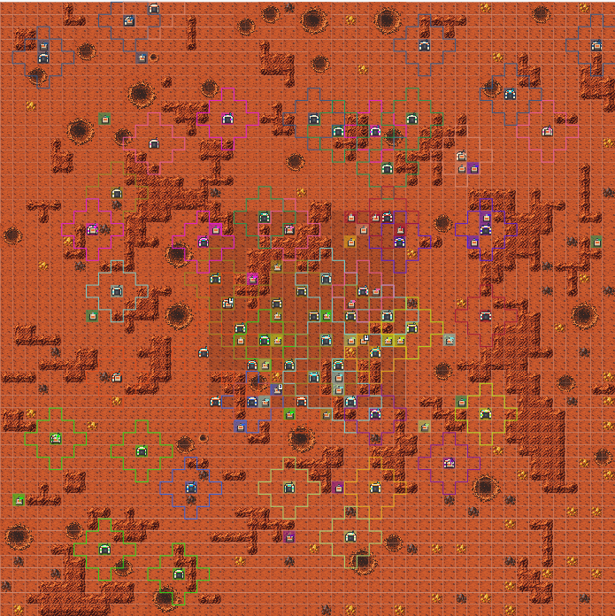

# Lucid Programming Competition 2026 bot

A C++20 bot for the Lucid Programming Competition (LPC) 2026, played as team **[BYU] Virginia**. In each match, 16 teams' bots share a 50×50 map and send one action per worker each turn. The team with the most gold banked after 480 turns wins.



## Results

| Round | Field | Place | Gold |
|---|---|---|---|
| Practice | 15 Intermediate bots | **1st** | 406 |
| Ranked 1 | 15 teams + 1 bot | **1st** | 362 |
| Ranked 2 | 14 teams + 1 bot | **2nd** | 453 (6 behind 1st) |
| Semifinals | 16 teams | 5th | 366 |
| Finals | 16 teams | 11th | 287 |

We started strong and made the finals, but slipped as other teams adapted between rounds. By the finals, several teams were claiming the rich center of the map with bases in the first 60 turns, which shut us out of the best gold.

## How it works

The bot puts a value in gold on every option and picks the best:

- **Map memory:** remembers terrain, deposits and enemy bases between turns.
- **Pathfinding:** 8-direction Dijkstra that accounts for slow terrain and prefers routes through unexplored tiles.
- **Task assignment:** each worker takes the task with the highest net value (gold gained minus time spent), without crowding a deposit another worker already has.
- **Investing:** recruits workers and builds bases when they pay back, trading carried gold for iron to fund them.
- **Endgame:** only takes on work whose gold can be deposited before the match ends.

[STRATEGY.md](STRATEGY.md) has the full model, the benchmarks and what each match taught us.

## Build and run

You need a C++20 compiler, CMake 3.20 or newer, and libcurl. On Windows, get libcurl through vcpkg.

```powershell
cmake -S . -B build -DCMAKE_TOOLCHAIN_FILE=C:/vcpkg/scripts/buildsystems/vcpkg.cmake
cmake --build build --config Release
$env:API_KEY = '<team key>'; $env:LUCID_API_BASE_URL = 'https://lpc.sh'
.\build\bin\lpc-bot.exe
```

## Simulator

`sim/` is an offline version of the game rules. It benchmarks strategy changes against bot opponents and copies of our own bot:

```powershell
cmake -S sim -B sim/build; cmake --build sim/build --config Release
.\sim\build\bin\lpc-sim.exe --seeds 1:20 --opponents prospector:15
```

## Files

| File | Purpose |
|---|---|
| `adaptive_hybrid.hpp` | The strategy |
| `bot_template.cpp` | Entry point; restarts the client after network errors |
| `bot_client.hpp`, `game_helpers.hpp`, `CMakeLists.txt` | Official competition starter files |
| `sim/` | Offline simulator and parameter sweep tool |
| `lpc2026-help.md` | The game rules |
